# 小鲸鱼（TinyWhale）

这次不是网页套壳：**登录只借用一次 WebKit 拿 token / cookie**，之后会话列表、历史消息、
发送、流式回答全部走 `chat.deepseek.com` 的内部 HTTP + SSE，再由 GTK4 控件重新排版。

回答统一使用气泡显示方式：


真实链路（对着本地 mock 跑）的截图：


---

## 它和上一个「网页外壳」的区别

| | `deepseek-desktop`（网页壳） | 本项目（原生） |
|---|---|---|
| 聊天内容 | WebKit 渲染官方网页 | GTK `Gtk.Label` / `Gtk.Box` 自己排版 |
| 数据 | 留在网页 DOM 里 | `history_messages` / SSE 的 JSON |
| 登录 | 一直在 WebView 里 | 登录一次后不再加载聊天页 |

代价是：走的是**非官方内部接口**，随时可能因 DeepSeek 改版失效；也请只在自己的账号上使用。

## 直接运行（免安装）

```bash
cd deepseek-native
./run.sh --demo      # 先看原生界面，不需要登录
./run.sh             # 真实账号
```

数据全部在本目录 `.profile/`：

```
.profile/
├── config/deepseek-native/session.json   # token + cookie（0600）
├── data/deepseek-native/                 # 登录用的 WebKit 数据
└── cache/
```

`./run.sh --fresh` 会清空 `.profile`（包括登录状态）。

如果系统缺 `gir1.2-webkit-6.0`，`run.sh` 会自动使用 `vendor/typelib/` 里附带的 GI 数据，
所以不需要先装任何系统包。

## 首次登录

1. `./run.sh`
2. 弹出的窗口里用手机号 / 密码 / 微信扫码登录（这个窗口只负责登录）。
3. 登录成功后会自动读取 `localStorage.userToken` 和 Cookie，写入 `session.json`，然后关闭登录窗口。
4. 之后主窗口不再加载网页；所有消息由 GTK 控件绘制。

如果自动读取失败，可以用「手动输入 Token」：从浏览器 DevTools →
Application → Local Storage → `https://chat.deepseek.com` → `userToken` 复制过来。
Cookie 可选，但带上更稳。

### 第一次真实登录怎么确认

登录后先退出应用，再跑一次体检（不会启动界面）：

```bash
./run.sh --doctor
```

正常会打印 `check:  OK，可见会话 N 个`；如果打印 `登录失效`，说明 token 没抓到，
重新 `./run.sh` 登录一次即可。也可以在应用菜单里点「诊断连接」。

真实接口探测：用一个假 token 请求 `fetch_page`，DeepSeek 返回的是
`code 40003 Invalid Token`（而不是 404），说明路由和鉴权格式是对的。

> 登录窗口关闭后，PoW 仍然需要一个隐藏的 WebKit 页面来跑 DeepSeek 自带的 JS solver
> （它的 `DeepSeekHashV1` 是自定义哈希，官方 WASM/JS 最稳）。这个页面不可见，
> 不参与界面渲染。`--pow python` 可以改用本项目里的 Python 实现（正确但很慢）。

## 界面结构（按参考图重做）

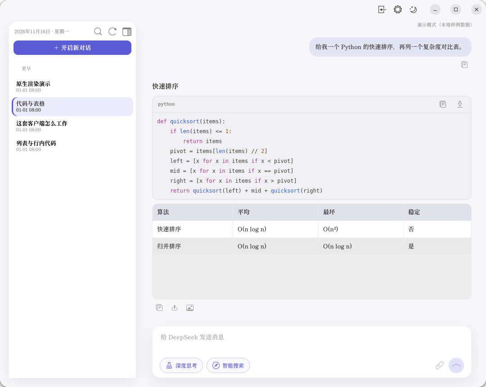

- 窗口标题栏左侧：DeepSeek 图标和文字；侧栏顶部左侧改成当天日期 · 星期
- 左侧栏：搜索/收起按钮、胶囊「开启新对话」、按
  「今天 / 昨天 / 7 天内 / 更早」分组的会话列表、底部账号与菜单
  （账号信息从 `/api/v0/users/current` 读取，读不到时这一行整体隐藏；
  默认头像使用你提供的 DeepSeek 鲸鱼图标，见下方说明）
- 会话列表底部有渐变淡出，最后一条会话自然过渡到账号行
- 重新登录 / 设置 / 主题切换放在 titlebar 右侧图标组里，关于移入设置页，账号行不再有三点菜单
- 空会话不再显示「新对话」占位标题
- 顶部：当前会话标题在左，状态/搜索计数在右（不再有显示/模型工具栏）
- 用户消息：浅紫气泡靠右，气泡下方是复制/编辑图标
- 助手消息：不再套白色卡片，正文直接铺开；上方是「已思考」折叠行，
  支持 Markdown、引用上标和参考来源卡片
- 输入区：大圆角卡片 + 深度思考/智能搜索药丸 + 附件；发送按钮始终是圆形，
  空输入时浅紫底 + 深色箭头，有内容时变成实心蓝 + 白色箭头（无阴影，保持清晰）

## 输入区（按参考图重做）

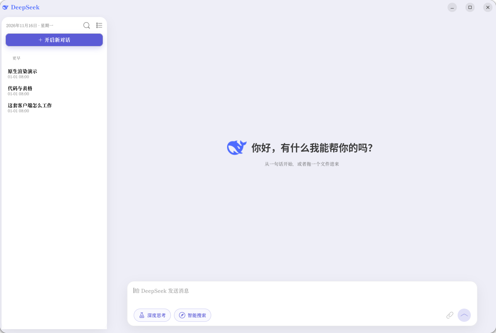

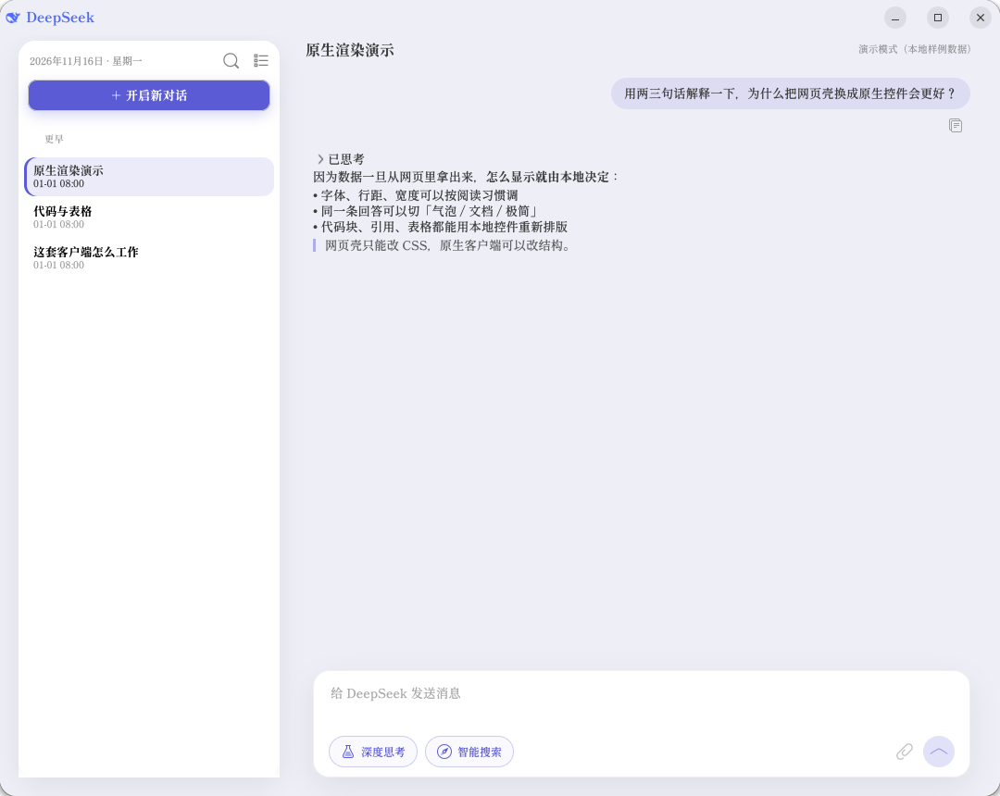

- 空会话时居中显示 logo + 「你好，有什么我能帮你的吗？」
- 输入框改成大圆角白卡：占位符「给 DeepSeek 发送消息」
- 「深度思考」「智能搜索」从顶部工具栏移进输入区，做成带图标的药丸开关
- 右侧是附件按钮 + 圆形发送按钮；输入为空时浅紫底，有内容时实心蓝
- 发送中变成圆形停止按钮，布局不跳动
- Enter 发送、Shift+Enter 换行、Ctrl+V 粘贴图片都保持
- 显示方式固定为气泡，主页面不再放「显示 / 模型」控件；模型由服务端决定

## 默认头像：DeepSeek 鲸鱼


使用你提供的鲸鱼图标，等比缩放，透明背景，不加圆形底板：

- 原图：`assets/avatar-whale.png`
- 240px 预览：`assets/avatar-user.png`
- 60px / 40px 头像：`assets/avatar-user-badge-60.png`、`assets/avatar-user-badge-40.png`
- 没有改鲸鱼造型，只做了等比缩放；头像区域本身透明

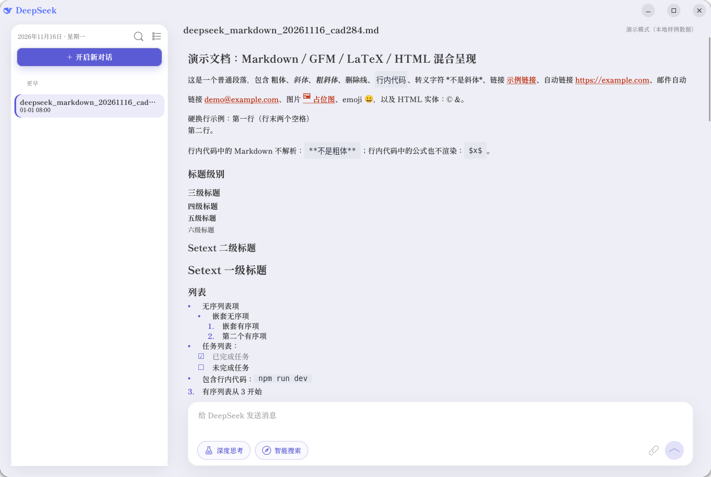

## 数学公式

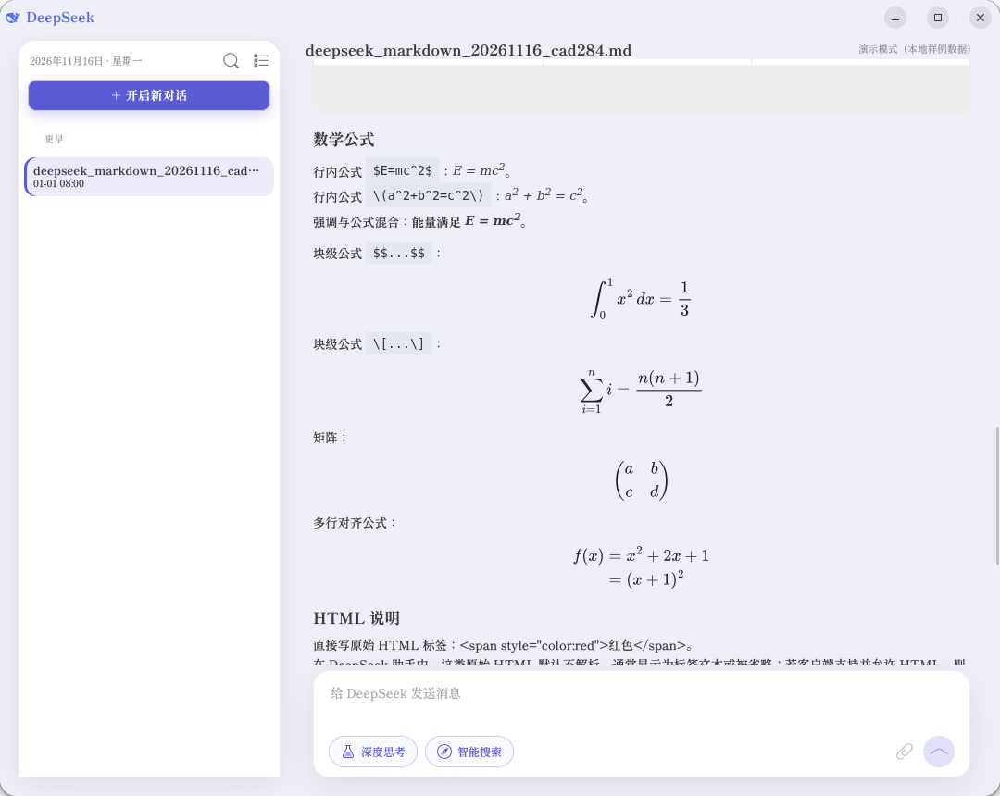

块级公式通过本地 Node + MathJax 生成 SVG，再转成透明底图片显示，因此
分数、积分/求和上下限、矩阵和对齐环境与网页端一致，不联网。

行内公式使用 Pango 的 rise 做真正的上下标，使用固定衬线字体。
公式字体由 MathJax 固定，字号跟随「正文」字号，不再单独设置。
MathJax/Node 不可用时才会回退到内置 Pango 排版。

## 设置

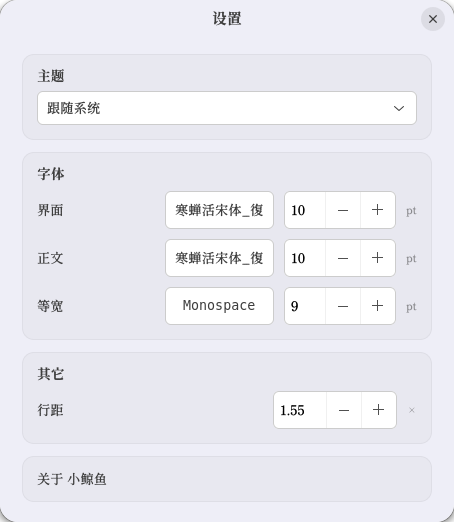

titlebar 右上角图标：重新登录 / 设置 / 主题切换；关于在设置页底部：

- 显示方式固定为气泡，不再提供设置
- **主题**：跟随系统 / 浅色 / 深色；titlebar 左侧可一键切换
- **字体**：分别设置
  - 界面
  - 正文
  - 等宽
- 界面字体和正文字体互不影响
- **行距**：可单独调整正文行距（1.0–2.8 倍），代码块保持固定行距
- 代码块缺字时自动回退到正文字体
- 数学公式的字体和字号跟随正文，不单独设置
- 字号框会填入当前有效默认值；手动填 `0` 可恢复跟随默认
- 字体选择立即应用，并写入
  `.profile/config/deepseek-native/settings.json`，下次启动保持
- 代码块跟随等宽字体，缺字时回退到正文编辑器字体；公式跟随正文编辑器字号重新排版
- 模型选择已移除：新会话由服务端决定模型，续聊沿用原会话模型

## 视觉风格（云白 / 深色）

按参考图调整过一版：淡紫灰背景、白色大圆角卡片、紫色主色、药丸形控件。
颜色全部走 GTK 主题变量，支持跟随系统或手动切换浅色 / 深色。


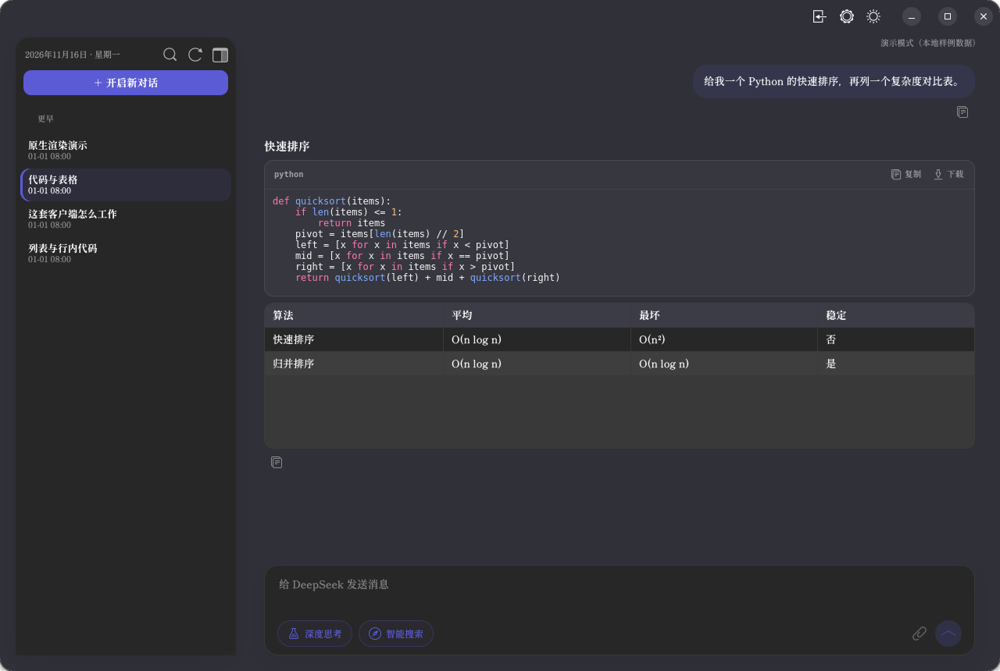

- 主色：`#5B5BD6`
- 背景：`mix(@theme_bg_color, #5B5BD6, 2%)`
- 卡片：`@theme_base_color`，18px 圆角 + 柔和阴影
- 侧栏、输入框、来源卡片、附件 chip 同一套圆角/阴影语言；助手正文保持无卡片排版
- 会话按时间分组，侧栏底部有账号入口

## 文件 / 图片上传

输入框左侧的回形针、拖拽文件到窗口、或在输入框里 `Ctrl+V` 粘贴图片都可以：

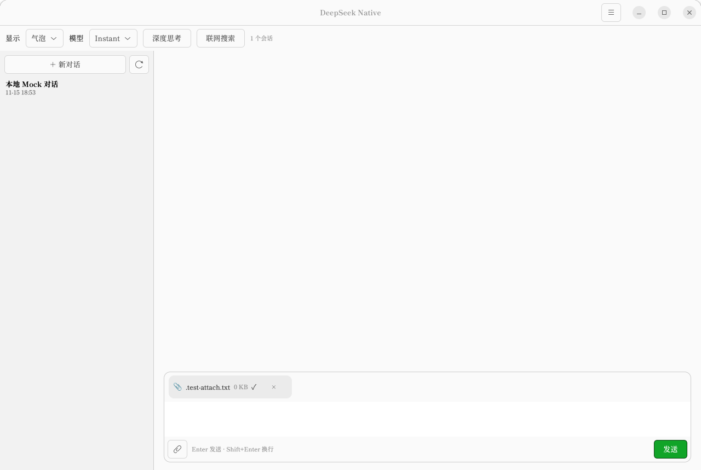

- 最多 50 个文件，单个最大 100MB
- 上传前会先解一次 `upload_file` 场景的 PoW，并带上网页版要求的
  `x-file-size`、`x-model-type`、`x-thinking-enabled`
- 上传后轮询 `/api/v0/file/fetch_files`，等文件解析成 `SUCCESS` 才允许发送
- 发送时把 file id 放进 `ref_file_ids`
- 失败的附件会在 chip 上标红，可以移除

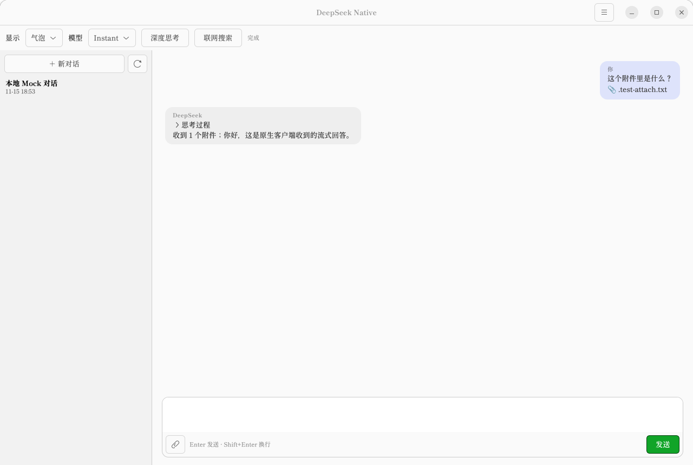

## 联网搜索引用

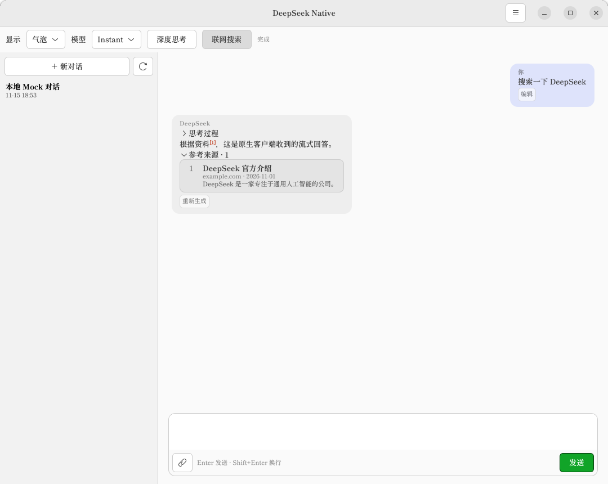

- 打开「联网搜索」后，SSE 里的 `TOOL_SEARCH` fragment 会带来 `results[]`
  （`url` / `title` / `snippet` / `siteName` / `publishedAt`）
- 正文里的 `[citation:N]` / `[reference:N]` 会被替换成可点击的上标
- 回答下方生成原生「参考来源 · N」卡片，点击卡片用系统浏览器打开
- 历史消息里的 `TOOL_SEARCH` fragment 也会解析成同样的卡片

## 会话分页 / 全文搜索

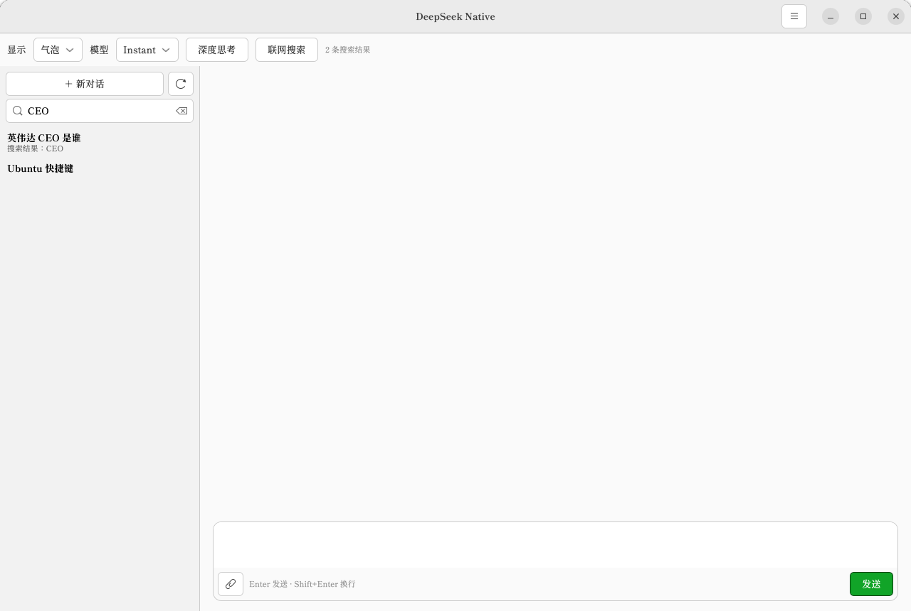

- 侧栏搜索框：输入后防抖 350ms，走 `POST /api/v0/index/query` 的 SSE，
  支持命中「消息正文」和「会话标题」两类结果
- 点击结果直接打开对应会话（暂不自动滚到命中消息）
- 最小窗口 900×600；侧栏固定不压缩，保证日期、会话标题和账号行完整
- 启动时不显示会话数量；会话列表每页 30 条，滚动到底自动用
  `lte_cursor.updated_at`（秒级）+ `lte_cursor.pinned` 加载下一页
- 结果按 id 去重，避免 cursor 边界重复

## 重新生成 / 编辑消息

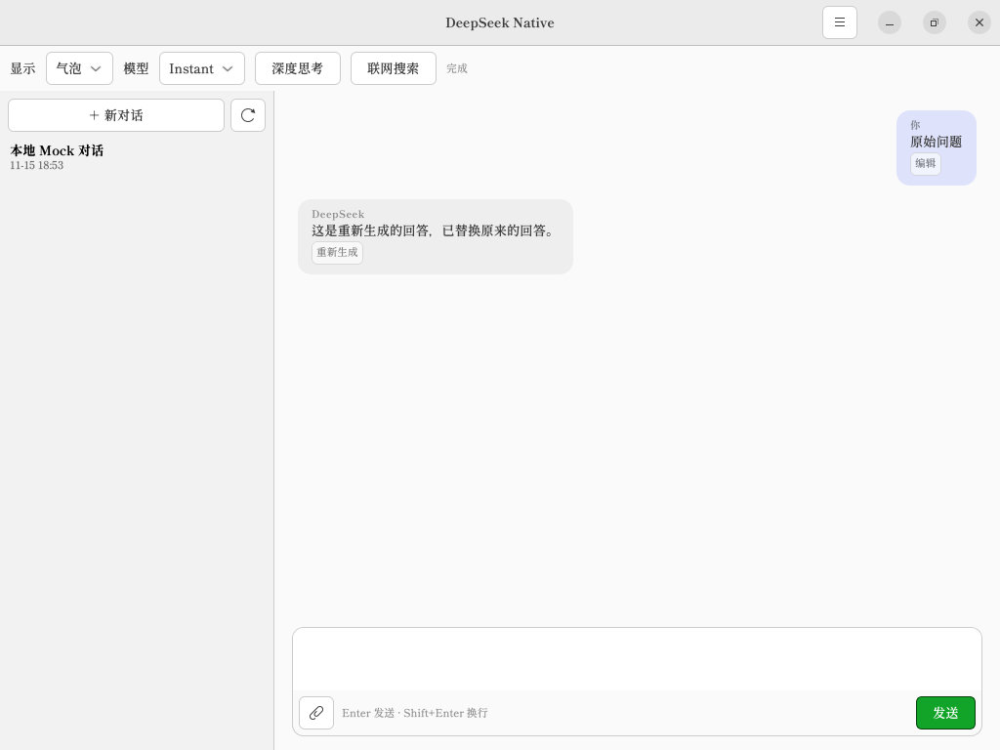

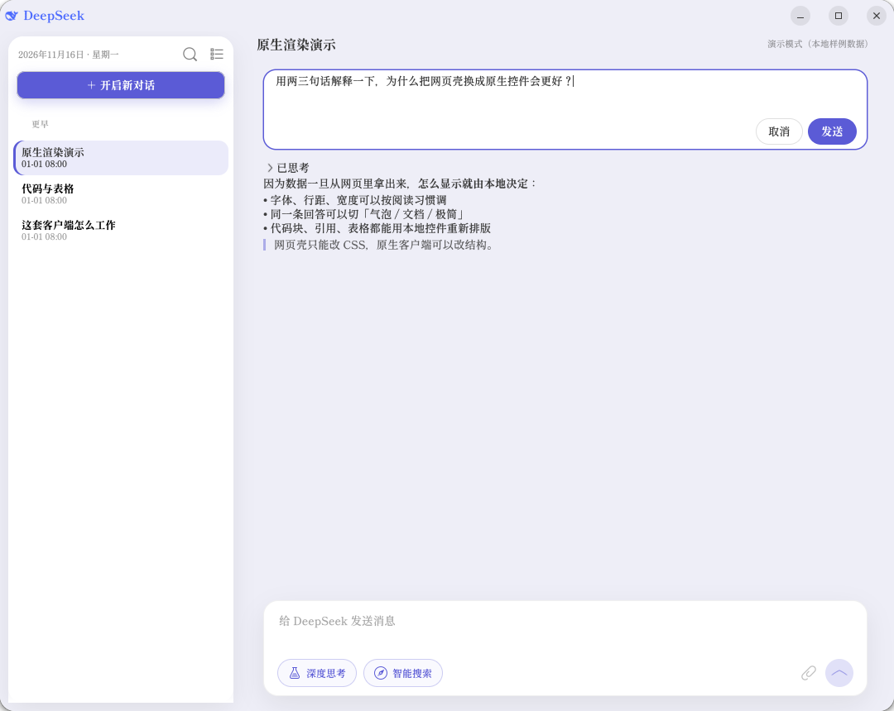

- 最后一条回答下面有「重新生成」：走 `/api/v0/chat/regenerate`，
  用 assistant 的 `message_id` 作为 `child_message_id`
- 最后一条提问下面有「编辑」：消息位置直接展开内联编辑框（蓝边框、取消/发送），
  发送后走 `/api/v0/chat/edit_message`，
  用 user 的 `message_id`，然后重新流式回答
- 两者都会删掉旧的尾部消息，用新的 SSE 结果替换；本地只维护线性视图
- 新发消息的 user id 如果 SSE 没带 `parent_id`，会在后台拉一次 history 补齐

限制：只支持操作最后一条；编辑不会保留原消息的附件；DeepSeek 服务端的
分支树在本地被折叠成一条线。

## 数据是怎么拿到的

```
登录 WebView ──(userToken + Cookie)──▶ session.json
                                        │
                     ┌──────────────────┴─────────────────┐
                     ▼                                    ▼
        GET chat_session/fetch_page             POST chat/create_pow_challenge
        GET chat/history_messages               POST chat/completion (SSE)
                     │                                    │
                     └──────────────┬─────────────────────┘
                                    ▼
                         GTK4 原生控件（气泡）
```

- **会话列表**：`/api/v0/chat_session/fetch_page`
- **历史**：`/api/v0/chat/history_messages`
- **发送**：先 `/api/v0/chat/create_pow_challenge`，本地/隐藏 WebKit 解出
  `x-ds-pow-response`，再 POST `/api/v0/chat/completion`
- **流式**：SSE 的 snapshot + JSON Patch 增量，解析成 `THINK` / `RESPONSE` 文本，
  每 80ms 合并一次重新渲染

PoW 的哈希不是标准 SHA3：网页版用的是 rate=136、23 轮自定义 Keccak 变体。
本项目里有逐字节对齐的 Python 实现（`api.py` 的 `_sponge_digest`，已和网页 JS 交叉验证），
以及默认的「隐藏 WebKit 跑官方 JS worker」快速路径。

## 没有账号怎么验证

仓库带了一个 mock server 和一套 `--token/--api-base` 参数：

```bash
python3 tests/mock_server.py 8767
# 另开终端：
./run.sh --token test-token --api-base http://127.0.0.1:8767 --pow python
```

mock 会返回会话列表、历史、一个假的 SSE 流（含 THINK 和增量），并用真实的
`DeepSeekHashV1` 校验 `x-ds-pow-response`。截图里的「本地 Mock 对话」就是这样跑出来的。

也可以直接跑协议层测试：

```bash
python3 - <<'PY'
import sys; sys.path.insert(0, '.')
from api import DeepSeekAPI, Session, solve_pow_python, pow_header
# 见 tests/ 或 README 末尾
PY
```

## 现在支持 / 还没做

支持：

- 登录 token / cookie 持久化
- 会话列表（按今天/昨天/7 天内/更早分组）、历史消息
- 侧栏搜索/收起、滚动自动分页、底部账号（能读取到用户信息时）
- 发送、SSE 流式增量、思考过程折叠
- 文件/图片上传（选择、拖拽、粘贴图片），解析完成后随消息发送
- 会话分页（30 条/页，滚动到底自动加载）
- 会话全文搜索（消息 + 标题）
- 联网搜索引用卡片与正文上标
- 重新生成最后一条回答（图标按钮）
- 分享当前会话：调用分享接口创建公开链接并复制到剪贴板
- 保存对话长图：把对话重新排版成 1080px 宽的页面数据，再直接输出为 JPEG；
  固定边距、约 25 个字符/行，顶部带 deepseek 品牌标识，不会截图现有界面
- 编辑最后一条提问并重新回答
- 气泡显示（固定）
- 深度思考 / 智能搜索开关（输入区内）
- 回答排版：ATX / Setext 标题（h1–h6）、段落、硬换行、嵌套列表、
  任务列表、多级引用卡片、分隔线、链接、自动链接、转义字符、行内代码 chip
- 表格：Gtk.Grid 渲染，左/中/右对齐、表头底色、隔行浅色、边框网格、
  横向滚动、`\|` 转义
- 引用式链接 / 图片、脚注、HTML 实体；原始 HTML 按文本显示
- 代码块：浅色卡片、语言标签、语法高亮、复制/下载；
  支持缩进代码块、列表里的围栏，以及外层四个反引号包住内层代码块的嵌套围栏
- 所有代码块都不提供纵向滚动，高度按内容完整展开，不设上限
- `markdown` / `md` 源码块不套语法高亮、不提供横向滚动，长行自动换行
- 其他语言代码块保持语法高亮，长行可横向滚动
- 数学公式：行间公式通过本地 MathJax 生成 SVG（分数、积分、求和、矩阵、
  对齐环境与网页端一致）；行内公式使用 Pango 上下标排版
- 公式由 vendored Node + MathJax 在本地渲染，不联网；MathJax/Node 不可用时
  自动回退到内置 Pango 排版
- 独立成段的远程图片异步加载；行内图片降级为链接
- 浅色 / 深色主题，支持跟随系统；titlebar 内一键切换
- 字体设置：界面 / 正文 / 等宽可设字体与字号；数学公式跟随正文
- 演示模式（无需账号）
- 本地 mock 全链路测试

还没做：

- 历史消息里的附件卡片（现在只在当次发送的 user 消息里显示 📎 文件名）
- 分享 / TTS
- 令牌自动刷新（失效时提示重新登录）

## 风险与注意

- **非官方协议**：接口、字段、PoW 规则都可能变；账号安全策略也可能调整。
- `session.json` 里是明文 token（权限 0600），不要分享这个文件。
- 本项目的 PoW 快速路径会在隐藏 WebKit 里执行 DeepSeek 网页版自带的 JS worker
  （`vendor/pow_worker.js`，来自 `fe-static.deepseek.com`，仅本地使用）。
- 真实账号已经跑通登录、对话、文件/图片上传、联网搜索引用；本地 mock 用于回归。
- 用户信息依赖 `/api/v0/users/current`；接口不可用时侧栏底部账号区会自动隐藏，
  不影响聊天。

## 依赖

- GTK 4 + WebKitGTK 6.0 + PyGObject（Ubuntu 26.04 自带）
- 系统缺 `gir1.2-webkit-6.0` 时用 `vendor/typelib/`，`run.sh` 自动处理
- 系统装了 `bubblewrap` 但当前环境不允许用户命名空间时，`run.sh` 会自动关闭 WebKit 沙箱并提示

## 文件

```
deepseek-native/
├── run.sh              # 免安装启动
├── app.py              # GTK4 界面、登录窗口、PoW 桥
├── api.py              # 内部 API、SSE、PoW、会话/历史
├── vendor/
│   ├── pow_worker.js   # 网页版 PoW solver（隐藏 WebKit 用）
│   └── typelib/        # 缺失时用的 WebKit 6.0 GI 数据
├── tests/mock_server.py
└── assets/
```
